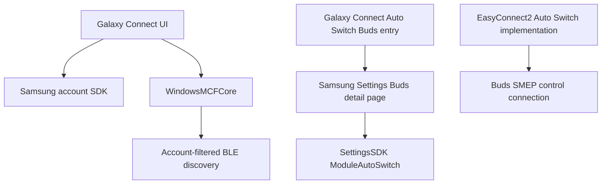

# Galaxy Connect analysis for native Buds switching

Analyzed the copied Samsung Settings 8.0.13.0 and SamsungContinuityService 2.1.11.0 artifacts. These are not verified as the versions on the separate Windows PC. Static file inspection only; no Windows binaries executed, personal credential stores accessed, or Linux worker/identity settings changed.

## Result

Galaxy Connect is a continuity/account frontend backed by MCF. Its Auto Switch Buds feature entry opens Samsung Settings; it does not contain the already recovered SMEP handoff implementation. MCF implements an additional account-filtered nearby-device discovery layer that our Linux prototype does not implement. That is a concrete interoperability gap, but no inspected path establishes it as the cause of the other three hosts disconnecting.

No four-host capacity or firmware eviction rule was established. Changing a displayed name, manufacturer constant, or Bluetooth address cannot be presented as a demonstrated fix. The current Linux implementation already sends the Windows-derived host descriptor and MDE v3 announcement; MCF discovery version markers are a separate protocol.

## Code paths

The ModuleAutoSwitch boundary and EasyConnect2 implementation are each established; the diagram deliberately does not invent a direct call between them where this pass has not resolved the module registration.

## Finding ledger

| Question | Finding | Evidence / confidence |
|---|---|---|
| Where does the Galaxy Connect Buds feature lead? | ContinuityFeatureApps.AutoSwitchBuds initializes the URI `samsungsettings15:-Go-AutoSwitchBudsDetail`; LaunchApp calls AppBase.Launch. | `peers-ContinuityFeatureApps.dll.il:1577`, observed instructions |
| What changes Buds settings? | SamsungSettings.AutoSwitchBudsVM uses SettingsSDK.ModuleFactory.Get("ModuleAutoSwitch").SetData. Its list comes from ExtensionCommon.BudsInfoServiceFactory. | `../SamsungSettings.il:159425`, `159510`, observed |
| Does Galaxy Connect UI implement native Buds requests? | No Buds/AutoSwitch/EasyConnect references were found in its decoded UI assembly; its settings bridge uses ModuleContinueApps. This is a bounded negative, not a whole-package absence claim. | `GalaxyConnectWinUI.il:177369`; UI ledger |
| How is account status communicated? | UI sign-in uses SASDK; its successful callback sends SamsungAccountQueryInfo through MCFProtocolHelper. | `GalaxyConnectWinUI.il:203220`, `205800`, observed |
| Does discovery require account-related state? | BlePacketSender.Publish calls GetAccountHash; if absent/empty it logs "No Account Hash info. Stop all Publishers" and calls StopAll. | `WindowsMCFCore.il:238921`, observed |
| How are discovery frames formed? | GetPersonalLtvFrame passes base context, LTV records, account hash and fingerprint checksum to MakeExPayload, then EncodeEx. BaseAccountHelper maintains current/previous hashes, expiry and an encoding table. | `WindowsMCFCore.il:242215`, `234236`, `235634`, observed |
| Is this merely a device-name check? | The decoded path depends on account hashes and encoded advertisement payloads. AccountEncodeDecode performs table-based XOR; this alone must not be described as secure authentication or AES. MCF connection authentication is a separate path. | `WindowsMCFCore.il:235634`, `235776`; derived from instructions |
| Is there an Auto Switch BLE format? | Commons defines AS_DEVICE=3; ASDeviceData parses compact Buds identifier/state, and BaseContextData defines an AutoSwitchSettings bit. | `peers-Commons.dll.il:42085`, `42870`, `44482`, observed schema |
| Does this Windows build demonstrably publish that Auto Switch bit? | Its GetBaseContextData actually emits feature byte `4 | continuitySettings`, leaving AutoSwitchSettings bit1 clear. The main ASDeviceData construction found here is the generic LTV parser. Do not blindly enable this bit based on its name. | `WindowsMCFCore.il:243701`, `251228`, observed code plus bounded search |
| Does version 3 imply three hosts? | No. ONE_TO_N_SUPPORT_VERSION=3 is an MCF version marker; it is not a demonstrated host-count limit and is separate from SMEP MDE v3. | `peers-Commons.dll.il:83274`, declaration scope |
| Is MCF's discovered-device registry capped at two/three/four? | The inspected AddDevice inserts into dictionaries without a count check or eviction. This says nothing about Buds firmware's active Bluetooth/profile capacity. | `peers-Commons.dll.il:78912`, bounded method conclusion |

ASDeviceData exposes HFP connected/active masks 0x80/0x40, A2DP connected 0x20, in-ear 0x04 and SPP-connectable 0x02. Its compact identifier uses the last address byte plus an address-byte XOR. These fields describe a format; no proven four-host keep-connected command follows from them.

## Implication for Linux

The Linux worker currently acts as an MDE-capable computer using the Buds SMEP channel, a private audio holding sink, and foreground/background routing. It does not implement Galaxy Connect's MCF account synchronization, account-filtered BLE publishing/scanning, or authenticated inter-device sessions. Implementing a compatible discovery participant is a plausible research direction, not yet a justified patch for the observed evictions.

In particular, the Samsung Settings native MDE packet wrapper passes zero for optional account-info-present fields. This inspection does not prove Linux must copy a Samsung account token into its SMEP packet, or that those zeros erase other hosts' accounts. No passwords/tokens or existing device MAC addresses should be guessed as substitutes for an untraced protocol field.

## What is answered and what remains

- Answered: package identity, Settings/Connect split, Buds deep link, configuration boundary, account sign-in notification and MCF discovery framing.
- Partially answered: Auto Switch-related peer schema exists; its end-to-end producer/consumer role in this Windows build is not established.
- Unresolved: why the three native hosts disconnect when Linux joins, the earbuds' simultaneous profile/link capacity, and the exact change needed for four hosts.

The next decisive experiment is a time-aligned capture of the native three-host baseline followed by Linux joining. It must distinguish Classic ACL, A2DP, HFP, SMEP and BLE state and capture the actual disconnect reason. Compare that with a native Windows host joining instead. A Windows-side packet trace is needed for the running newest Galaxy Connect; a static mounted Windows drive cannot supply it. This avoids mistaking an idle renderer, profile release, or firmware host eviction for the same failure.

## Evidence and reproducibility

- `core-rea.json`: REA metadata/member summaries, exact paths, MVIDs and SHA-256 identities.
- `ui-findings.md` / `ui-artifact.json`: UI call paths and artifact identity.
- `peers-findings.md` / `peers-artifacts.json` / `peers-rea-metadata.json`: peer schema, feature launch, scope and negative-search limitations.
- Full offline CIL dumps retained beside these files; decoded with installed `ikdasm`, without loading a CLR target.
- Root main-executable identity: SHA-256 `ec06ba1b0948f90643b4ea88018d6e9688db6283b61036a636963e5ec91a4380`, MVID `dc571e36-90fa-4abc-8df0-ec36d1a322f2`, .NET Framework 4.7.2. Galaxy Connect UI is .NET 8.
- REA main metadata parent: `ev_85a8dabdb6eb7924bdef7126c49f91200604af4e6cf654bf5755b9681c6b4fb2`; selected members parent: `ev_8705fa1ff1528d8d2416f4750af31dc113a4fdd4e4c33eb03a104bdc6478d85e`.

No native analysis session was opened in this pass; target-free managed inspections were used. No compatibility or runtime claim follows solely from a metadata inventory.
